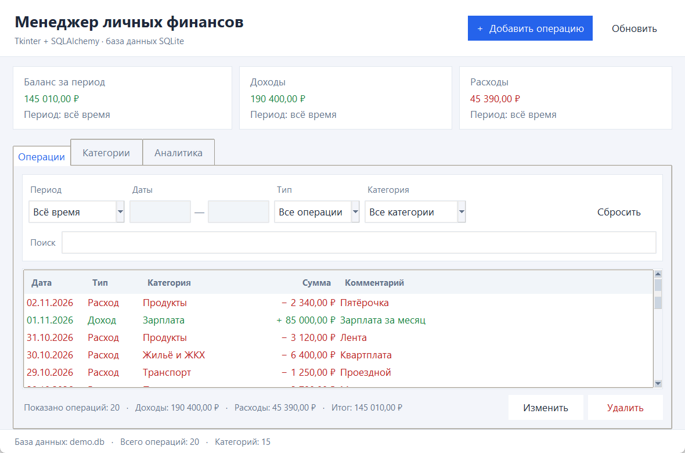
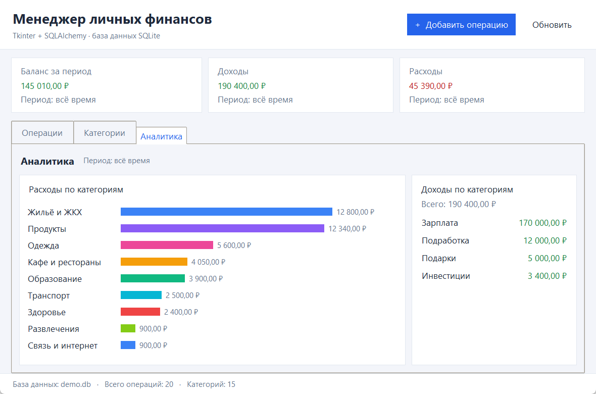
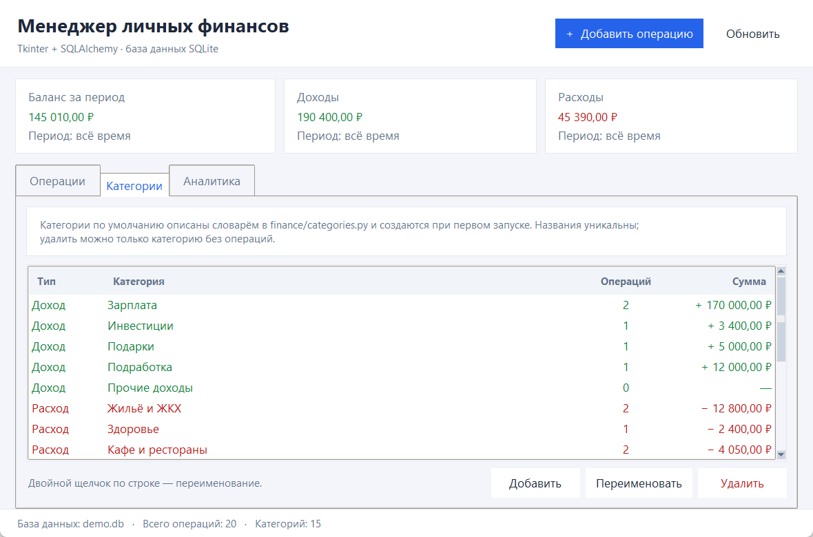

# Менеджер личных финансов

Учебный проект: приложение для учёта личных доходов и расходов по категориям.
Интерфейс — **Tkinter**, работа с базой — **SQLAlchemy**, хранилище — **SQLite**.



## Возможности

- добавление, изменение и удаление доходов и расходов;
- категории с проверкой уникальности названий (создание, переименование, удаление);
- фильтрация операций по периоду, типу, категории и тексту комментария;
- сводка за период: баланс, доходы, расходы;
- вкладка «Аналитика»: суммы расходов и доходов по категориям, диаграмма;
- горячие клавиши и меню;
- демонстрационные данные одной командой.

| Аналитика | Категории |
|---|---|
|  |  |

## Запуск

Требуется Python 3.10+ с установленным Tkinter (подходит обычная сборка с python.org).

```bat
python -m venv .venv
.venv\Scripts\activate
pip install -r requirements.txt
python main.py
```

Либо просто запустить `run.bat` — он сам использует `.venv`, если она создана.

> В папке уже лежит готовая `.venv` (Python 3.13 с Tkinter и SQLAlchemy),
> поэтому `run.bat` работает сразу. Если хотите собрать окружение заново —
> выполните команды выше.

Полезные параметры:

```bat
python main.py --demo          :: добавить примеры операций в пустую базу
python main.py --db my.db      :: указать свой файл базы данных
```

База `finance.db` создаётся рядом с `main.py` при первом запуске.

## Горячие клавиши

| Клавиши | Действие |
|---|---|
| `Ctrl+N` | новая операция (расход) |
| `F5` | обновить данные |
| двойной щелчок по операции | редактировать |
| `Delete` | удалить выбранную операцию |
| `Esc` / `Enter` в диалоге | отмена / сохранение |

## Структура проекта

```
main.py                  точка входа, разбор аргументов командной строки
finance/
  settings.py            неизменяемые настройки приложения (кортежи)
  categories.py          словарь категорий по умолчанию и CategoryStore
  models.py              ORM-модели Category и Transaction
  database.py            движок SQLite, создание схемы, сессии, начальные данные
  repository.py          запросы, фильтры, итоги, бизнес-правила
  dto.py                 неизменяемые структуры для обмена с интерфейсом
  utils.py               форматирование денег и дат, границы периодов
  demo.py                демонстрационные операции
  ui/
    app.py               главное окно (сводка, операции, категории, аналитика)
    transaction_dialog.py  диалог операции
    category_dialog.py     диалог категории
    theme.py             цвета, шрифты и стили ttk
    dpi.py               корректное масштабирование в Windows
tests/test_service.py    тесты логики и разбора данных
docs/                    скриншоты
```

## Как выполнены требования задания

| Требование | Реализация |
|---|---|
| Приложение на Tkinter | `finance/ui/app.py`, `transaction_dialog.py`, `category_dialog.py` |
| Работа с БД через SQLAlchemy | `finance/models.py`, `finance/database.py`, `finance/repository.py` |
| Категории хранятся в словарях | `DEFAULT_CATEGORIES: dict[str, tuple[str, ...]]` и словари `CategoryStore` (`id -> категория`, `название -> категория`) в `finance/categories.py` |
| Неизменяемые настройки — кортежи | `WINDOW_SIZE`, `MIN_WINDOW_SIZE`, `KINDS`, `PERIODS`, `CHART_COLORS` в `finance/settings.py`; frozen dataclass'ы в `finance/dto.py` |
| Таблица транзакций | модель `Transaction` (`transactions`: сумма, дата, комментарий, ссылка на категорию) |
| Таблица категорий | модель `Category` (`categories`: название, вид операции, признак категории по умолчанию) |
| Учёт доходов и расходов с категориями | вкладки «Операции», «Категории», «Аналитика», сводные карточки за период |

Особенности реализации:

- сумма хранится как `Numeric(12, 2)`, в интерфейсе — `Decimal`;
- внешние ключи SQLite включены, удаление категории с операциями запрещено;
- категории по умолчанию создаются только при пустой таблице, поэтому удалённые пользователем категории не возвращаются;
- поиск по кириллице выполняется без учёта регистра.

## Тесты

```bat
.venv\Scripts\python.exe -m unittest discover -s tests -v
```

Проверяются создание категорий, добавление/изменение/удаление операций,
фильтры, итоги, защита от удаления используемой категории и разбор сумм/дат.
